# Outputs summary: every figure of the DAS simulation project

This document describes every figure produced in the project, in the order in which they should appear in the report. All numbers come from the real runs of the Simulink model (`model/das_model.slx`) and its scripts. Repository paths are relative to the project root; the images shown here are the PNG files.

**Setup used for all runs (unless a figure says otherwise)**

| Item | Value |
|---|---|
| Fibre | 2 km standard single-mode fibre, attenuation 0.2 dB/km, group index 1.468, 1959 scatterers (one per 1.02 m) |
| Samples per trace (Ns) / pulses | 1969 samples (1.02 m each) / 2001 pulses (one simulation step = one pulse) |
| Probe pulse | width Tw = 100 ns (10 samples), spatial resolution Δz = cTw/2n = 10.2 m, repetition frequency f_rep = 10 kHz |
| Source | narrow-linewidth laser 5 kHz, 10 mW, 99:1 coupler (signal 0.99, local oscillator 0.01), EDFA +10 dB, circulator 0.8 dB per pass |
| Receiver | responsivity 0.9 A/W, receiver noise 1 nA rms per sample (independent noise per sample and per pulse) |
| Vibration events | event 1: starts at 1200 m, 1 rad, 200 Hz; event 2: starts at 1500 m, 0.5 rad, 500 Hz; each disturbed section is 10 m long |

---

# 1. Background

## Figure B1: Development timeline of DAS

**1. File:** `background/figures/das_timeline.pdf` (vector) and `das_timeline.png`; script `background/scripts/fig_das_timeline.m`.

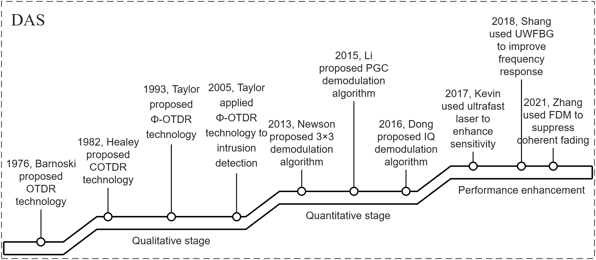

**2. What it shows:** A double-line "road" that climbs three steps from left to right. Step 1 is grey (qualitative stage), step 2 is light blue (quantitative stage), step 3 is light coral (performance enhancement). Ten open circles mark the milestones; each has a vertical stem to a label directly above it.

**3. Key numbers:** Ten milestones in three stages. Qualitative (4): 1976 Barnoski OTDR, 1982 Healey COTDR, 1993 Taylor Φ-OTDR, 2005 Taylor Φ-OTDR applied to intrusion detection. Quantitative (3): 2013 Newson 3×3 demodulation, 2015 Li PGC demodulation, 2016 Dong IQ demodulation. Performance enhancement (3): 2017 Kevin ultrafast laser for sensitivity, 2018 Shang UWFBG for frequency response, 2021 Zhang FDM against coherent fading.

**4. What it proves:** Nothing is validated here. It gives the historical logic: first detecting the event (qualitative), then recovering the vibration waveform (quantitative), then improving sensitivity, frequency response and fading (performance).

**5. Use in the report:** Introduction / background section. Point to make: the step from OTDR to Φ-OTDR to COTDR is the step from "where" to "how strong and how fast". Pairs with Figure B2 (the same three systems as block diagrams).

**6. Caption:** *Development of distributed acoustic sensing in three stages: qualitative (1976–2005, OTDR, COTDR, Φ-OTDR and its first use for intrusion detection), quantitative (2013–2016, 3×3, PGC and IQ demodulation to recover the vibration waveform) and performance enhancement (2017–2021, ultrafast laser, UWFBG and frequency-division multiplexing against coherent fading). Adapted from Shang et al., Sensors 2022, Fig. 1.*

**7. Notes:** Adapted from the figure of the review paper (redrawn, not copied); cite Shang et al. 2022. Positions along the stairs are ordered, not to scale in time.

## Figure B2: Evolution OTDR → Φ-OTDR → COTDR

**1. File:** `background/figures/das_evolution.pdf` and `das_evolution.png`; model `background/model/das_evolution.slx`; script `background/scripts/build_das_evolution.m`.

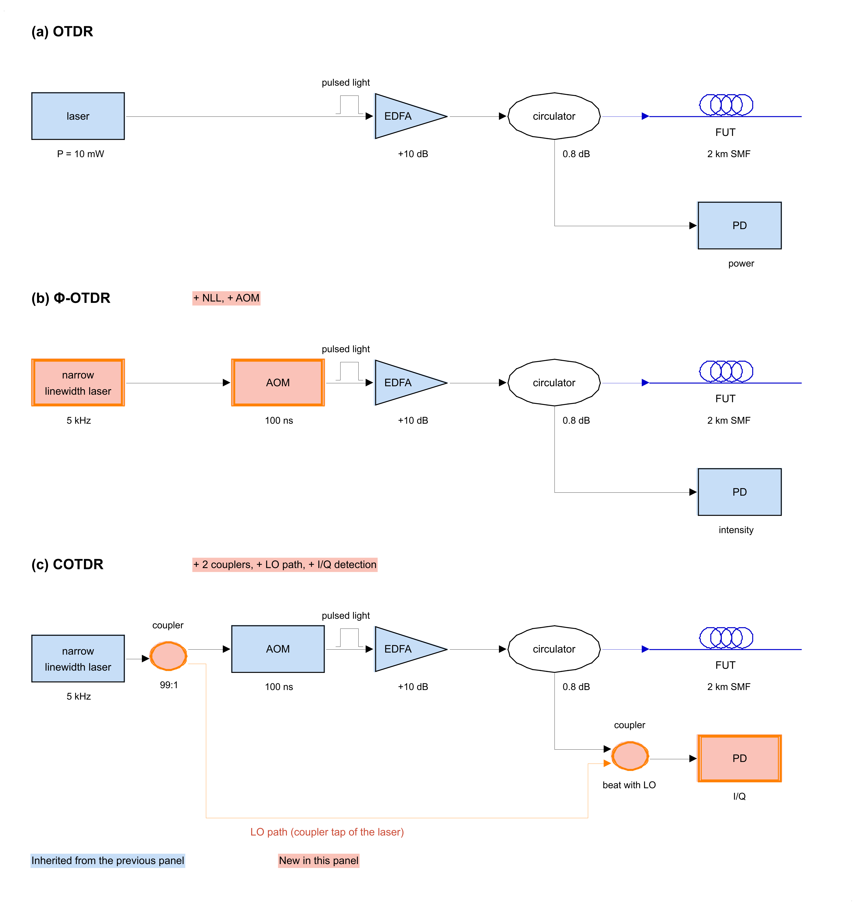

**2. What it shows:** Three stacked Simulink diagrams on one grid: (a) OTDR: pulsed laser, EDFA, circulator, fibre under test (FUT, blue coil), photodetector below the circulator. (b) Φ-OTDR: the laser becomes a narrow-linewidth laser (NLL) followed by an acousto-optic modulator (AOM); both are drawn in coral with a thick orange border. (c) COTDR: a coupler (99:1) taps the laser, the tap (LO path, orange line) goes along the bottom to a second coupler where it meets the backscatter, then an I/Q photodetector (coral). Light blue boxes are inherited from the previous panel. The parameters are printed under the blocks.

**3. Key numbers:** NLL linewidth 5 kHz, laser 10 mW, AOM 100 ns, EDFA +10 dB, circulator 0.8 dB, coupler 99:1, FUT 2 km SMF, R = 0.9 A/W.

**4. What it proves:** The incremental structure of Shang Figs. 2–4: coherence needs the narrow-linewidth laser and the pulse-cutting AOM; phase (waveform) recovery needs the local oscillator and I/Q detection.

**5. Use in the report:** System-model section, before the full model (Figures M0–M4). Point: the simulated model contains exactly these components, and each addition is motivated by a new capability. Pairs with B1 (history) and M0 (the real model).

**6. Caption:** *Evolution of the three systems (adapted from Shang et al., Sensors 2022, Figs. 2–4), drawn with the Simulink blocks used in the simulation. (a) OTDR: pulsed laser, EDFA, circulator, fibre under test and power detection. (b) Φ-OTDR: a narrow-linewidth laser and an AOM give coherent probe pulses, so the intensity depends on the fibre phase. (c) COTDR: a 99:1 coupler taps the laser as local oscillator, which beats with the backscatter in a second coupler; the I/Q photodetector recovers the complex signal and hence the phase. Light blue: inherited from the previous panel; coral: new at this stage.*

**7. Notes:** It is a presentation figure (the blocks contain the model blocks but the diagram is not simulated). Simplifications: the circulator is drawn forward-only with its return pass shown as the line leaving its bottom, and the second coupler stands for the optical mixing (the model computes E_R · conj(LO)).

---

# 2. System model

## Figure M0: Complete model

**1. File:** `figures/model_sections/00_full_model.pdf` and `.png`; model `model/das_model.slx`.

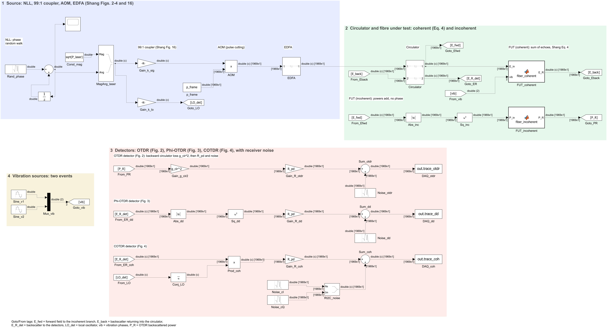

**2. What it shows:** The whole Simulink model in one image with signal sizes and types on every line (`double (c) [1969x1]` means a complex vector of 1969 samples). Four coloured areas: (1) source (blue), (2) circulator and fibre (green), (3) detectors (pink), (4) vibration sources (yellow). Goto/From tags with the same name are connected (`E_fwd`, `E_back`, `E_R_det`, `LO_det`, `vib`, `P_R`).

**3. Key numbers:** Ns = 1969 samples per trace, 2001 pulses, 1.02 m per sample, `[1969x1]` on all optical lines, three outputs logged as `1969 × 1 × 2001` (To Workspace `trace_otdr`, `trace_dd`, `trace_coh`; the last one is complex).

**4. What it proves:** The one-step-equals-one-pulse approach: fast time (along the fibre) is the vector index, slow time (pulse to pulse) is the simulation time, so a 2 km fibre and 2001 pulses are simulated with a light model.

**5. Use in the report:** System-model section, as the overview figure. Then give one figure per section (M1–M4) with the explanation. Pairs with B2.

**6. Caption:** *Complete Simulink model of the DAS simulation. One simulation step represents one optical pulse, so every signal line carries a full trace of 1969 samples (one per 1.02 m of fibre). The model has four sections: source, circulator and fibre under test, detectors (OTDR, Φ-OTDR, COTDR) and vibration sources. Goto and From blocks with the same tag are connected.*

**7. Notes:** It is a single connected model; the areas only group the blocks. The Goto/From tags replace long wires. Use the PDF for a sharp vector version.

## Figure M1: Section 1, source

**1. File:** `figures/model_sections/01_source.pdf` and `.png`.

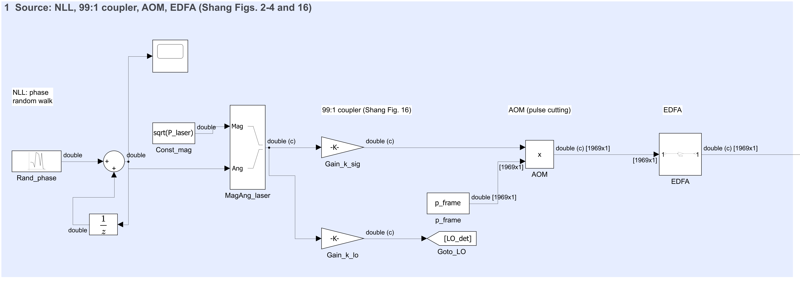

**2. What it shows:** From left to right: the narrow-linewidth laser (Random Number, Sum and Unit Delay accumulating a random phase, a constant magnitude, a Magnitude-Angle to Complex block), the 99:1 coupler as two gains (signal arm up, local-oscillator arm down to the `LO_det` tag), the AOM (a product with the pulse frame `p_frame`) and the EDFA subsystem.

**3. Key numbers:** Phase-noise variance 2πΔν·Ts = 3.14 rad² per pulse (Δν = 5 kHz, Ts = 100 µs); laser field magnitude 0.1 (P = 10 mW); coupler field gains √0.99 = 0.995 and √0.01 = 0.1 (measured magnitudes after the coupler 0.0995 and 0.01); pulse frame = 10 ones followed by 1959 zeros (100 ns); EDFA field gain 3.16 (+10 dB).

**4. What it proves:** The source model of Shang Fig. 16 (the 99:1 coupler) and the pulse generation of Figs. 3–4: a complex baseband field with a laser-linewidth phase noise, cut into pulses by the AOM.

**5. Use in the report:** System-model section, "source and pulse" subsection. Pairs with M0 and B2.

**6. Caption:** *Section 1, source. The narrow-linewidth laser is a random-walk phase (linewidth 5 kHz) with constant magnitude, giving a complex field. A 99:1 coupler (two field gains) splits it into the signal arm and the local oscillator. The AOM multiplies the field by the pulse frame (100 ns), producing one 1969-sample pulse frame per step, and the EDFA applies a +10 dB gain (Shang Figs. 2–4 and 16).*

**7. Notes:** Gains are on the field (square root of the power gains). The model does not include the optical path delay between laser and LO (phase noise cancels perfectly in the COTDR).

## Figure M2: Section 2, circulator and fibre under test

**1. File:** `figures/model_sections/02_circulator_fut.pdf` and `.png`.

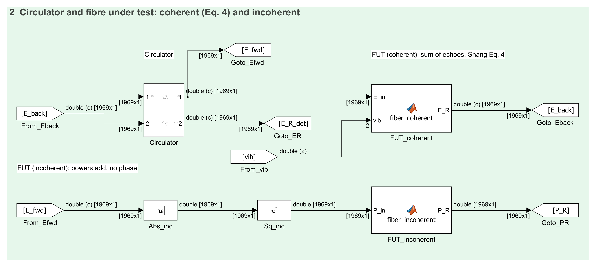

**2. What it shows:** The circulator subsystem (forward path to the fibre, backward path to the detectors), the coherent fibre block `FUT_coherent` (inputs `E_in` and `vib`, output `E_R`), and below it the incoherent chain `From_Efwd`, `Abs_inc`, `Sq_inc`, `FUT_incoherent` giving `P_R`.

**3. Key numbers:** Circulator loss 0.8 dB per pass (field gain 0.912, power factor 0.83); 1959 random Rayleigh scatterers, backscattered power fraction 5.3·10⁻⁸ per cell; the returning field E_R is `[1969x1]` complex.

**4. What it proves:** Shang Eq. (4): the received field is the sum of the echoes of all scatterers, each delayed by one sample per cell, so it is a convolution of the pulse with the fibre response h = r · att · exp(jφ). In the incoherent branch the powers add, so the vibration phase has no effect (conventional OTDR is phase-insensitive).

**5. Use in the report:** System-model section, "fibre model" subsection. Then the results F1–F2 and the validation E4 show the two behaviours. Pairs with F2 (speckle) and E4.

**6. Caption:** *Section 2, circulator and fibre under test. The coherent fibre block sums the field echoes of all fibre cells (a convolution of the probe pulse with the fibre impulse response, Shang Eq. 4), with the vibration phase applied from the disturbed section on. The incoherent fibre block works on the power |E|² of the probe, so powers add and the vibration phase has no effect. The backscattered field returns through the circulator towards the detectors.*

**7. Notes:** The incoherent branch uses the mean backscattered power (a low-coherence source averages the speckle). The circulator return is wired through Goto/From tags `E_back` and `E_R_det`.

## Figure M3: Section 3, detectors

**1. File:** `figures/model_sections/03_detectors.pdf` and `.png`.

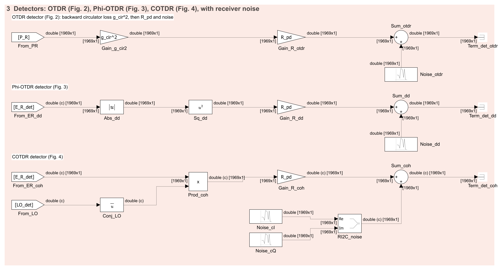

**2. What it shows:** Three branches stacked in shared columns (From, Abs, Square, Gain, Sum, output). OTDR: `P_R` → backward circulator gain g_cir² → R_pd → add noise → To Workspace. Φ-OTDR: |E_R|² → R_pd → noise. COTDR: E_R × conj(LO) → R_pd → complex noise (two independent noises into a Real-Imag to Complex block).

**3. Key numbers:** Responsivity R_pd = 0.9 A/W; noise 1 nA rms per sample (independent random seeds for every sample and every noise source); mean photocurrent of the OTDR 32 nA (−74.9 dB re 1 A at 100 m); the Φ-OTDR intensity has median 22.9 nA; the COTDR median amplitude |C| = 1.42 µA.

**4. What it proves:** Shang Figs. 2, 3 and 4: power detection (OTDR), square-law detection of the coherent field (Φ-OTDR), and coherent detection with a local oscillator (COTDR), where the product with the conjugate LO gives I + jQ and cancels the common laser phase. The g_cir² factor makes the three detectors see the same circulator losses.

**5. Use in the report:** System-model section, "detection" subsection; compare the three branches in a table. Pairs with E4 (OTDR versus Φ-OTDR) and F5–F6 (COTDR).

**6. Caption:** *Section 3, the three detection branches. OTDR: backscattered power, backward circulator loss and responsivity. Φ-OTDR: square-law detection |E_R|² of the coherent backscatter. COTDR: the backscatter is multiplied by the conjugate of the local oscillator (homodyne detection), giving the complex signal I + jQ. All branches add independent receiver noise (1 nA rms per sample); the complex noise has independent real and imaginary parts.*

**7. Notes:** COTDR uses homodyne detection (I and Q directly) instead of heterodyne at the laser frequency, so no high sample rate is needed: mention this as a simplification. The OTDR branch has the extra gain g_cir² (the same backward loss as the coherent field).

## Figure M4: Section 4, vibration sources

**1. File:** `figures/model_sections/04_vibration.pdf` and `.png`.

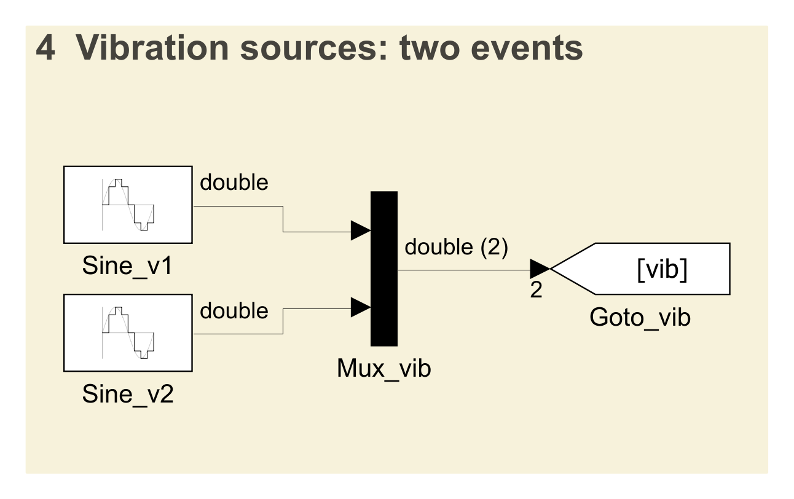

**2. What it shows:** Two Sine Wave blocks combined by a Mux into a 2-element vector sent to the fibre block through the tag `vib`.

**3. Key numbers:** Event 1: 1 rad, 200 Hz (starting at 1200 m); event 2: 0.5 rad, 500 Hz (starting at 1500 m); sample time 100 µs (one value per pulse); each event ramps the phase to its full value over a 10 m section and the phase stays after the section.

**4. What it proves:** The disturbance model: the vibration is a round-trip phase change that accumulates from the disturbed section on, so the phase difference between a point before and a point after the event is the vibration waveform.

**5. Use in the report:** System-model section (excitation), next to the fibre model. Pairs with F3–F6 and with the validation experiments, which change these two events.

**6. Caption:** *Section 4, vibration sources. One sine wave per vibration event (1 rad at 200 Hz and 0.5 rad at 500 Hz), sampled once per pulse and combined into the vibration vector that sets the extra phase of the fibre from the disturbed section on.*

**7. Notes:** The validation experiments change z_v, f_v, Phi0, Tw, f_rep, the random seed and the receiver noise through the override structure `ovr` of `das_init`.

---

# 3. Results (default parameters)

## Figure F1: Conventional OTDR trace

**1. File:** `figures/fig1_otdr_trace.png`.

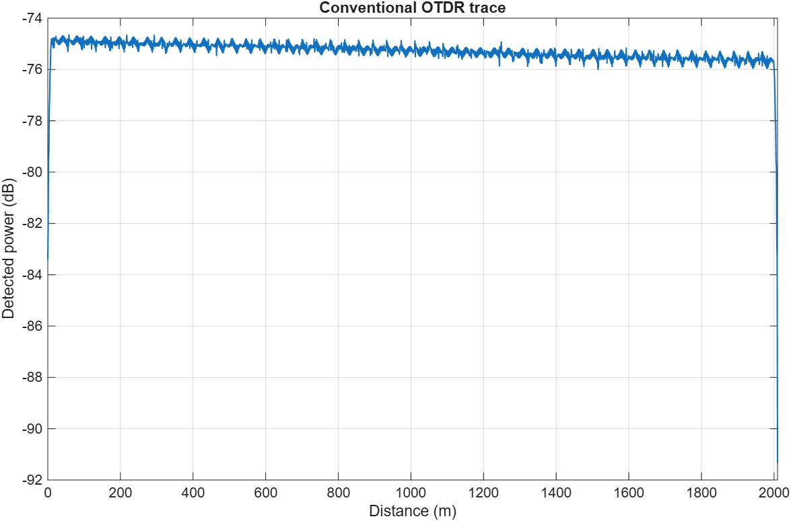

**2. What it shows:** Detected photocurrent in dB (re 1 A) against distance (0–2000 m): a nearly straight line falling slowly, with small ripple (receiver noise); it rises at the near end and falls sharply at the far end of the fibre.

**3. Key numbers:** Fitted slope **0.400 dB/km** (expected 2 × 0.2 = 0.400 dB/km); level −74.9 dB at 100 m and −75.6 dB at 1900 m (0.7 dB less over 1.8 km, as expected).

**4. What it proves:** The OTDR power equation: the backscattered power decays with the round-trip attenuation, twice the one-way fibre attenuation. It also validates the fibre and detector models.

**5. Use in the report:** Results section, first figure (sanity check of the fibre model) or the OTDR part of the system comparison. Pairs with F2 (coherent trace of the same fibre).

**6. Caption:** *Conventional OTDR trace. The detected power falls on a straight line with a slope of 0.400 dB/km, twice the fibre attenuation (0.2 dB/km) because the light travels the fibre twice. The sharp changes at the ends are the pulse entering and leaving the fibre.*

**7. Notes:** The vertical axis is the photocurrent in dB re 1 A (the label says "detected power"). The fit excludes two pulse widths at each end.

## Figure F2: Single Φ-OTDR trace

**1. File:** `figures/fig2_phiotdr_trace.png`.

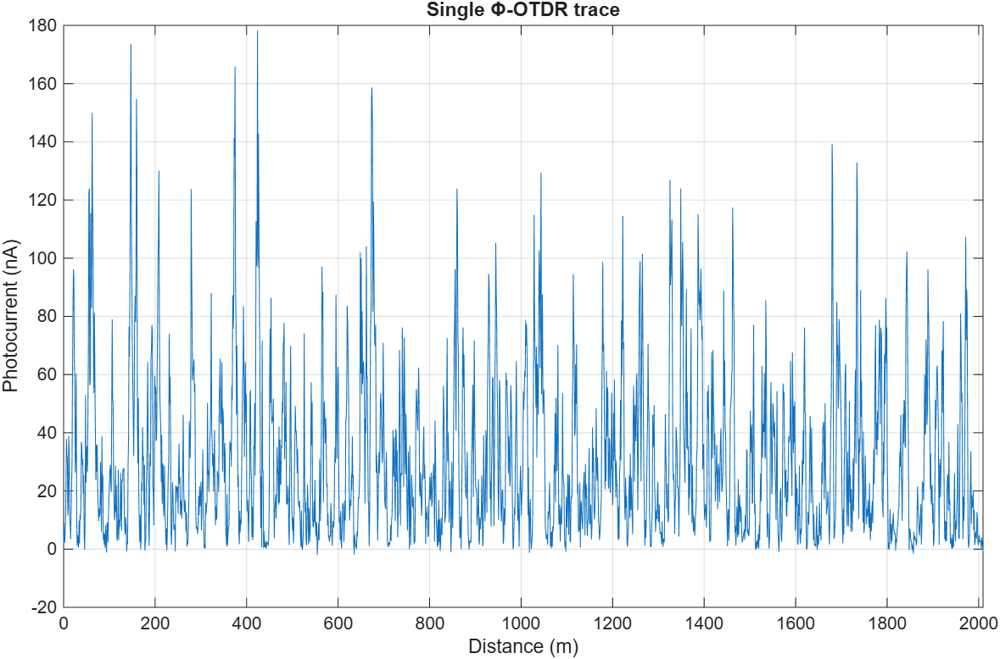

**2. What it shows:** Photocurrent (nA) against distance for one pulse of the coherent system: a random, spiky pattern (speckle) with deep dips.

**3. Key numbers:** Median 22.9 nA, maximum 178 nA, minimum −1.9 nA (the receiver noise lets the value go below zero at the dips); standard deviation divided by the mean = 0.91.

**4. What it proves:** Coherent fading (Shang Section 3.2): the interference of the echoes of many scatterers inside the pulse gives a random intensity. A ratio std/mean close to 1 is the signature of fully developed speckle (exponentially distributed intensity).

**5. Use in the report:** Results section, directly after F1, to contrast with the smooth OTDR line. Discussion point: the dips are where the phase measurement will be unreliable (see E5). Pairs with F1 and E5.

**6. Caption:** *Single Φ-OTDR trace. With a coherent probe the backscattered fields interfere, so the intensity along the fibre is a random speckle pattern instead of a smooth line. The deep dips are coherent-fading points.*

**7. Notes:** Same fibre as F1 (seed 1). The pattern is fixed in space; only the vibration changes it over time.

## Figure F3: Φ-OTDR waterfall

**1. File:** `figures/fig3_waterfall.png`.

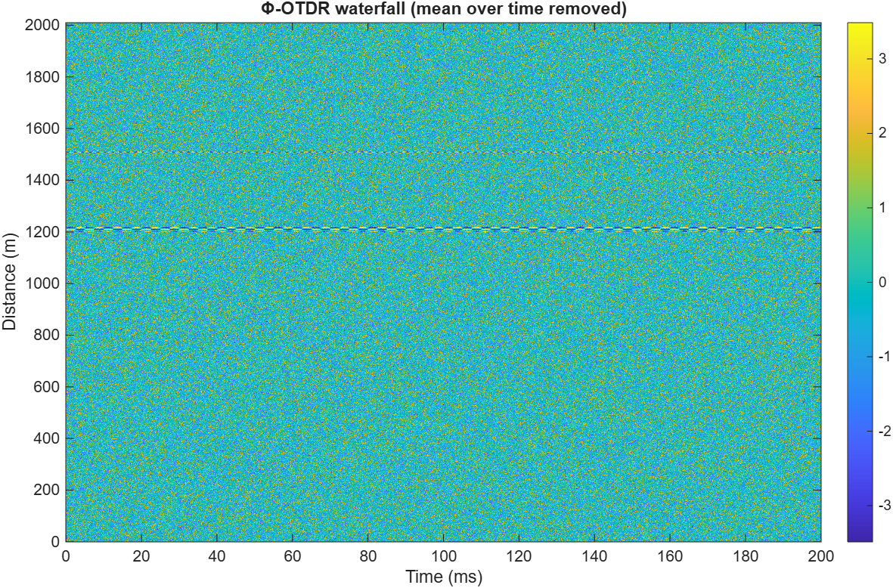

**2. What it shows:** Distance (0–2000 m, vertical) against time (0–200 ms, horizontal); the colour is the change of the photocurrent after the static speckle pattern has been removed (mean over time subtracted, colour scale ±3.5 nA). Two horizontal lines oscillate in time, at about 1200 m and 1500 m; elsewhere only fine noise.

**3. Key numbers:** Events at 1200 m (strong, 200 Hz, 40 cycles in 200 ms) and 1500 m (weaker, 500 Hz); noise 1 nA rms.

**4. What it proves:** The Φ-OTDR sees where a vibration occurs: only the perturbed positions change over time. This is the "distributed" sensing principle.

**5. Use in the report:** Results section: the main visual of detection and localisation. Pairs with F4 (the quantitative localisation of the same data) and F5.

**6. Caption:** *Φ-OTDR waterfall (distance versus time) after removing the static speckle pattern. The two vibration events appear as oscillating horizontal lines at about 1200 m and 1500 m; the rest of the fibre only shows receiver noise.*

**7. Notes:** The mean over time is subtracted for display; without that the speckle hides the events.

## Figure F4: Event localisation

**1. File:** `figures/fig4_localisation.png`.

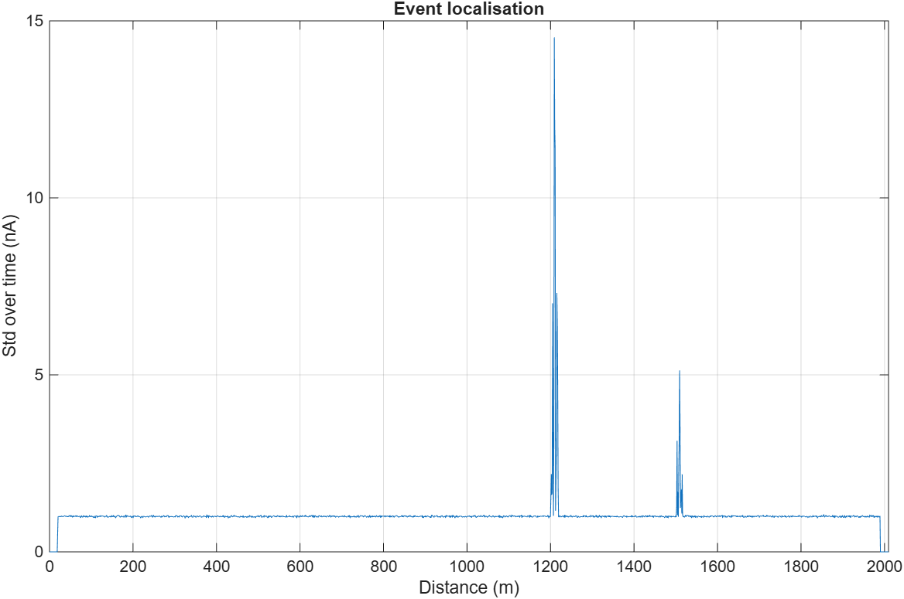

**2. What it shows:** Standard deviation over time of the intensity (nA) against distance: a flat noise floor with two peaks.

**3. Key numbers:** Noise floor 1.00 nA (equal to the receiver noise); strongest peak **14.5 nA at 1209.0 m**; second peak 5.1 nA at 1509.2 m; the perturbed sections start at 1200 m and 1500 m and are 10 m long.

**4. What it proves:** Localisation with the spatial resolution of the pulse (Δz = 10.2 m): the peak falls inside the 10 m disturbed section (1200 to 1210 m), 9 m after its start, which is within one resolution cell; the stronger vibration (1 rad) gives the higher peak. The peak/floor ratio of 14.5 shows the detection margin.

**5. Use in the report:** Results section, quantitative localisation after F3. Point: the position error is within one resolution cell. Pairs with F3 and with E1–E2 (resolution).

**6. Caption:** *Event localisation. The standard deviation of the Φ-OTDR intensity over time is flat (1 nA, the receiver noise) except at the vibrations. The strongest peak is at 1209 m (the perturbed section starts at 1200 m) and the weaker event is found at 1509 m; the positions are within the spatial resolution of 10.2 m.*

**7. Notes:** The fibre ends are excluded from the search. The detected position (1209 m) is not the start of the section (1200 m): say that the position is accurate to about one resolution cell.

## Figure F5: Recovered vibration waveform (COTDR)

**1. File:** `figures/fig5_recovered_phase.png`.

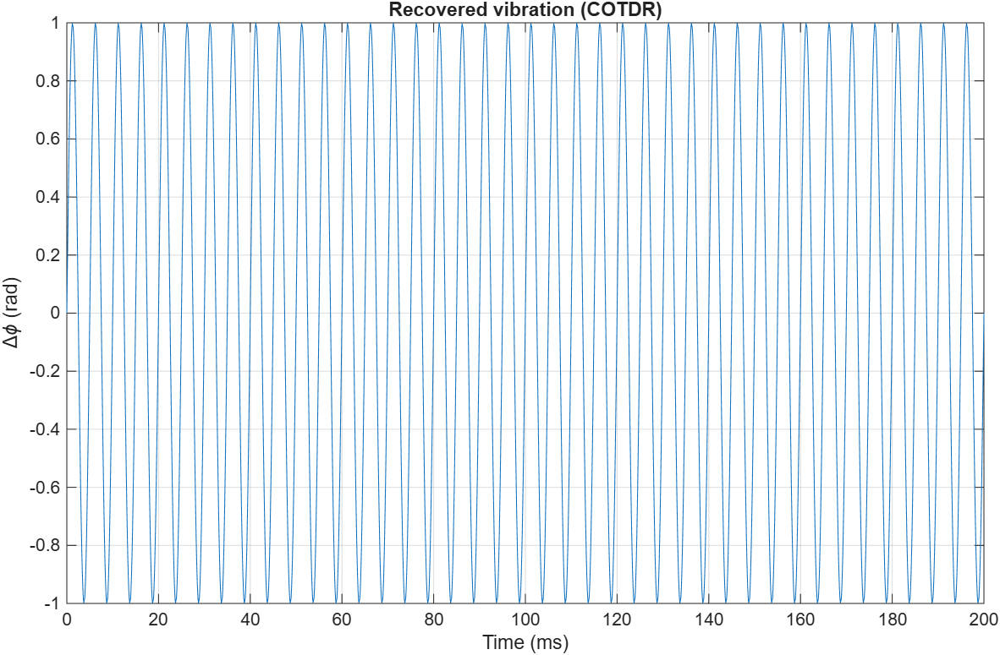

**2. What it shows:** Phase difference Δφ (rad) against time (0–200 ms): a clean sine with 40 cycles between −1 and +1 rad.

**3. Key numbers:** Amplitude **1.00 rad**; frequency 200 Hz (period 5 ms); residual to an ideal sine 0.03 rad; weakest backscatter amplitude at the two sample points 1.56 times the median (no fading at this position).

**4. What it proves:** The COTDR recovers the vibration waveform quantitatively: the differential phase between a point after and a point before the event cancels the common laser phase noise and equals the injected 1 rad sine. This validates the E_R · conj(LO) detection.

**5. Use in the report:** Results section, after localisation (where, then what). Pairs with F6 (its spectrum) and with E5 (when this fails).

**6. Caption:** *Vibration recovered with the COTDR. The phase difference between a point after and a point before the event, with the common laser phase cancelled, is a sine of amplitude 1.00 rad at 200 Hz, the injected vibration (residual 0.03 rad).*

**7. Notes:** The two sample points are 2 pulse widths before and 1 pulse width after the localised position. The mean is removed and the phase is unwrapped.

## Figure F6: Vibration spectrum

**1. File:** `figures/fig6_spectrum.png`.

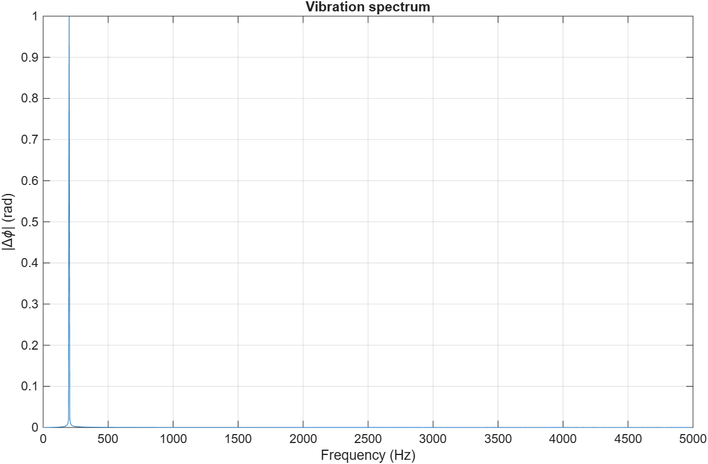

**2. What it shows:** Amplitude (rad) against frequency (0–5000 Hz): a single sharp line at the low-frequency end and nothing else.

**3. Key numbers:** Peak **1.00 rad at 199.9 Hz** (the FFT bin spacing is 5.0 Hz); the plot extends to f_rep/2 = 5 kHz.

**4. What it proves:** The frequency and the amplitude of the vibration are recovered; the measurable range is up to f_rep/2 (see E3 for the limit).

**5. Use in the report:** Results section, last of the baseline results. Pairs with F5 and E3.

**6. Caption:** *Spectrum of the recovered vibration: a single line of 1.00 rad at 200 Hz, the frequency and amplitude of the injected vibration. The axis ends at f_rep/2 = 5 kHz.*

**7. Notes:** The 500 Hz event at 1500 m does not appear because the phase is taken at the strongest event only.

---

# 4. Validation experiments

## Figure E1: Spatial resolution

**1. File:** `figures/experiments/exp1_resolution.png`.

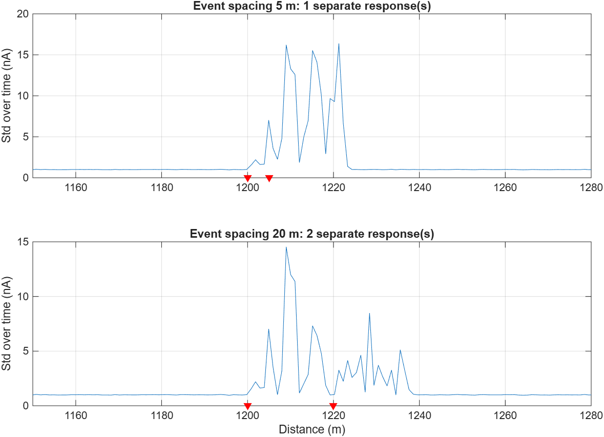

**2. What it shows:** Two panels of the standard deviation over time against distance (1150–1280 m). Top: events 5 m apart; bottom: events 20 m apart. Red triangles mark the true event positions.

**3. Key numbers:** Δz = cTw/2n = **10.2 m**. Events 5 m apart: **one** response of 20.4 m. Events 20 m apart: **two** separate responses of 15.3 m each, with a gap at the noise floor between them.

**4. What it proves:** The spatial resolution equation Δz = cTw/2n (Shang Eq. 5): events closer than the resolution cannot be separated, events farther apart can.

**5. Use in the report:** Validation section. Pair with E2 (the same equation tested by changing Tw).

**6. Caption:** *Validation of the spatial resolution Δz = cTw/2n = 10.2 m. Two vibration events 5 m apart (top) give a single merged response, while events 20 m apart (bottom) give two separate responses. Red triangles: true event positions.*

**7. Notes:** Both events have the same strength (1 rad, 200 Hz and 500 Hz); with the default 0.5 rad second event its response is weak and the count of events becomes ambiguous. A "response" is a run of samples above twice the noise floor, separated from the next by at least 3 samples at the floor. The event positions are z_v = [1200 1205] and [1200 1220].

## Figure E2: Pulse width

**1. File:** `figures/experiments/exp2_pulse_width.png`.

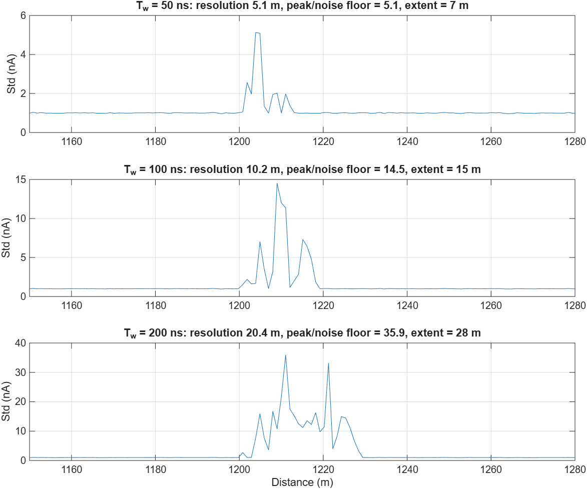

**2. What it shows:** Three panels (Tw = 50, 100 and 200 ns) of the standard deviation over time against distance around the 1200 m event; the title of each panel gives the resolution, the peak over the noise floor and the extent of the response.

**3. Key numbers:**

| Tw | Resolution Δz | Peak | Noise floor | Peak/floor | Extent of the response |
|---|---|---|---|---|---|
| 50 ns | 5.1 m | 5.1 nA | 1.00 nA | 5.1 | 7.1 m |
| 100 ns | 10.2 m | 14.5 nA | 1.00 nA | 14.5 | 15.3 m |
| 200 ns | 20.4 m | 35.9 nA | 1.00 nA | 35.9 | 27.6 m |

**4. What it proves:** The trade-off between resolution and signal-to-noise ratio: a longer pulse carries more energy (higher peak over the noise floor) but a worse (larger) Δz and a wider response.

**5. Use in the report:** Validation section after E1; discussion: choose Tw according to the application (a short pulse for precise position, a long one for weak events). Pairs with E1.

**6. Caption:** *Effect of the pulse width. Tw = 50, 100 and 200 ns give spatial resolutions of 5.1, 10.2 and 20.4 m. The response of the event widens (7.1, 15.3, 27.6 m) while the detected signal over the noise floor rises (5.1, 14.5, 35.9): the resolution versus SNR trade-off.*

**7. Notes:** The extent is the distance over which the response stays above twice the noise floor within 60 m of the peak. The peak value is speckle-dependent (one fibre realisation), so use the trend, not the exact ratios.

## Figure E3: Frequency limit (aliasing)

**1. File:** `figures/experiments/exp3_aliasing.png`.

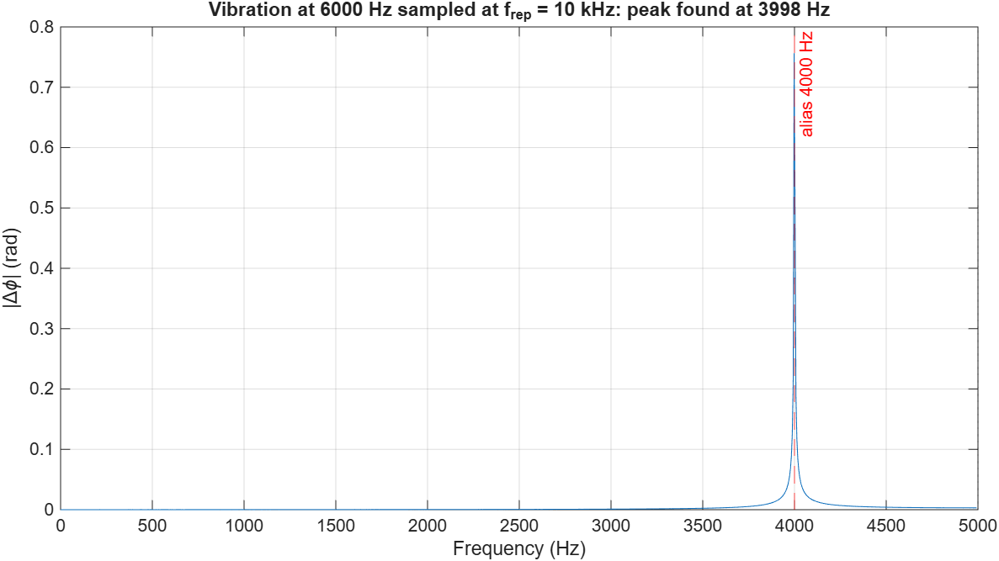

**2. What it shows:** The spectrum of the recovered vibration (0–5000 Hz) for a 6000 Hz vibration sampled at f_rep = 10 kHz: a single line at about 4000 Hz, marked by a red dashed line "alias 4000 Hz".

**3. Key numbers:** True vibration 6000 Hz, f_rep = 10 kHz (Nyquist limit 5 kHz); detected frequency **3998 Hz** (FFT bin spacing 5 Hz); the alias is |6000 − 10000| = 4000 Hz; the peak reads 0.76 rad.

**4. What it proves:** The frequency limit of the pulse-by-pulse measurement: a vibration above f_rep/2 folds back (aliasing), and f_rep itself is limited by f_rep ≤ c/(2nL) = 51 kHz for 2 km (otherwise the traces overlap).

**5. Use in the report:** Validation / discussion: the maximum measurable frequency is a system limit fixed by the fibre length (L ≤ c/(2n·f_rep)). Pairs with F6 (the normal case).

**6. Caption:** *Frequency limit. A 6 kHz vibration sampled at a pulse repetition frequency of 10 kHz appears at 3998 Hz, the alias 10 − 6 = 4 kHz, because it is above f_rep/2. The pulse repetition frequency is itself limited to c/(2nL) so that the backscattered traces of consecutive pulses do not overlap.*

**7. Notes:** The reading of 0.76 rad (instead of 1 rad) is the scalloping loss of the FFT (4000 Hz falls 0.4 bin away from the nearest FFT bin: sinc(0.4) = 0.76), not a loss of signal. The vibration at 1200 m has the injected frequency 6000 Hz; the second event stays at 500 Hz.

## Figure E4: OTDR versus Φ-OTDR

**1. File:** `figures/experiments/exp4_otdr_vs_phiotdr.png`.

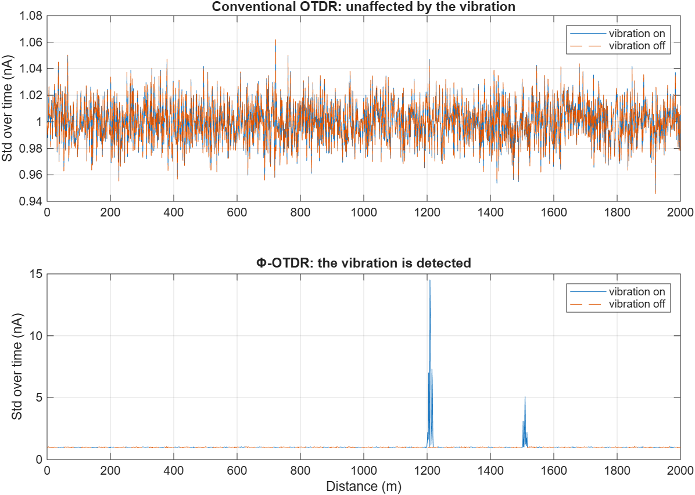

**2. What it shows:** Two panels of the standard deviation over time against distance (0–2000 m), with the vibration on (solid) and off (dashed). Top: conventional OTDR, two overlapping curves around the 1 nA noise floor. Bottom: Φ-OTDR, a flat line when off and two peaks at 1200 m and 1500 m when on.

**3. Key numbers:** OTDR: largest difference between the traces with and without vibration = **0** (identical, same noise seeds); Φ-OTDR peaks 14.5 nA (1209 m) and 5.1 nA (1509 m) over a 1.00 nA floor; relative change of the Φ-OTDR intensity 0.12.

**4. What it proves:** The conventional OTDR is phase-insensitive (powers add, the vibration phase has no effect) while the Φ-OTDR is phase-sensitive: the strongest argument of the comparison between the two systems.

**5. Use in the report:** Validation section; the central figure of the OTDR versus Φ-OTDR comparison table. Pairs with M2 (incoherent versus coherent fibre) and F3.

**6. Caption:** *OTDR versus Φ-OTDR with the same vibration. Top: the conventional OTDR gives identical traces with and without the vibration (difference 0), so it is blind to it. Bottom: the Φ-OTDR shows two peaks at the events only when the vibration is on, because its coherent signal depends on the fibre phase.*

**7. Notes:** "Vibration off" means Phi0 = [0 0]. The random seeds are the same in both runs, which is why the OTDR traces are exactly identical.

## Figure E5: Coherent fading

**1. File:** `figures/experiments/exp5_fading.png`.

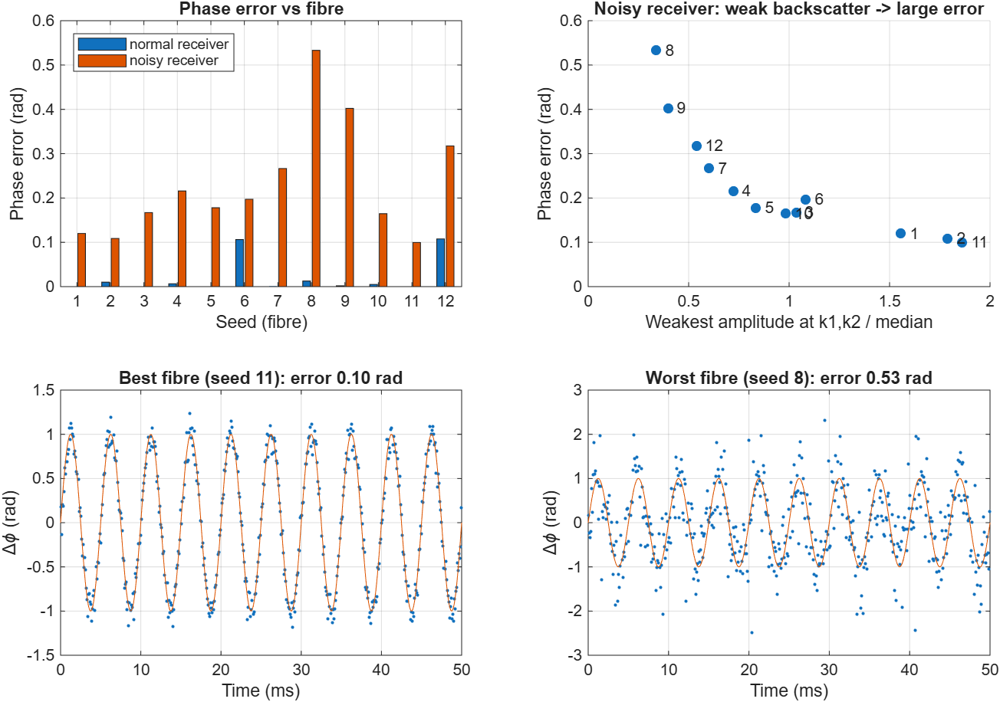

**2. What it shows:** Four panels. Top left: phase error per fibre (seeds 1–12) for the normal and for a noisy receiver. Top right: for the noisy receiver, phase error against the weakest backscatter amplitude at the two sample points (relative to the median); each dot is labelled with its seed. Bottom: recovered waveform (dots) against the injected 200 Hz, 1 rad sine (line) for the best fibre (seed 11) and the worst fibre (seed 8).

**3. Key numbers:** Twelve different fibres. Normal receiver (1 nA): phase error between 0.000 and 0.108 rad for all fibres, even when the weakest amplitude is 0.34 times the median. Noisy receiver: error from **0.10 rad** (seed 11, amplitude ratio 1.86) to **0.53 rad** (seed 8, ratio 0.34); other low-amplitude seeds: seed 9 (0.40 → 0.40 rad), seed 12 (0.54 → 0.32 rad); high-amplitude seeds: seed 2 (1.79 → 0.11 rad), seed 1 (1.56 → 0.12 rad).

**4. What it proves:** Coherent fading (Shang Section 3.2): the backscatter amplitude is random along the fibre, and where it is small the phase measurement becomes noisy; the error grows steadily as the amplitude drops.

**5. Use in the report:** Validation and discussion: the limitation of the Φ-OTDR/COTDR and the motivation of the performance-enhancement stage (e.g., frequency-division multiplexing, Figure B1). Pairs with F2 and F5.

**6. Caption:** *Coherent fading in twelve different fibres. With a noisy receiver the phase error of the recovered vibration grows as the backscatter amplitude at the two sampled points falls (top right): the best fibre (seed 11) follows the injected 200 Hz, 1 rad sine with 0.10 rad error, while the worst fibre (seed 8, an event on a fading point) has a 0.53 rad error (bottom). With the normal receiver all fibres give an error below 0.11 rad.*

**7. Notes (important):** (a) The normal receiver (1 nA) gives clean waveforms for every fibre, so no fading effect appears with it. (b) To show the effect, **receiver noise was added to the two COTDR samples** (200 nA rms per I and Q component, compared with a median amplitude of 1.42 µA); since the noise is additive at the detector output this is equivalent to a receiver with a larger noise, but it is an emulation, state it in the report. (c) The phase error is the circular standard deviation against the injected waveform (not affected by phase wraps). (d) The fix suggested by Shang is to move the sample points (k1, k2) away from the fading point.

---

# Summary table

| Figure | Section | What it proves |
|---|---|---|
| B1 `das_timeline` | Background | Historical logic of DAS: detection, waveform recovery, performance |
| B2 `das_evolution` | Background / system model | OTDR → Φ-OTDR → COTDR structure (Shang Figs. 2–4) |
| M0 `00_full_model` | System model | One step = one pulse; Ns = 1969 samples per trace |
| M1 `01_source` | System model | Laser phase noise, 99:1 coupler, AOM pulses, EDFA (Fig. 16) |
| M2 `02_circulator_fut` | System model | Fibre as convolution (Eq. 4); incoherent branch adds powers |
| M3 `03_detectors` | System model | Power, square-law and homodyne detection with receiver noise |
| M4 `04_vibration` | System model | Vibration as a phase accumulating along the fibre |
| F1 `fig1_otdr_trace` | Results | OTDR slope 0.400 dB/km = 2 × attenuation |
| F2 `fig2_phiotdr_trace` | Results | Coherent fading: random speckle (std/mean 0.91) |
| F3 `fig3_waterfall` | Results | Events at 1200 m and 1500 m seen over time |
| F4 `fig4_localisation` | Results | Localisation at 1209 m (14.5 nA over a 1 nA floor) |
| F5 `fig5_recovered_phase` | Results | Phase recovered: 1.00 rad at 200 Hz |
| F6 `fig6_spectrum` | Results | Frequency and amplitude recovered (200 Hz, 1.00 rad) |
| E1 `exp1_resolution` | Validation | Δz = cTw/2n: 5 m merge, 20 m resolved |
| E2 `exp2_pulse_width` | Validation | Resolution versus SNR trade-off (5.1 / 10.2 / 20.4 m) |
| E3 `exp3_aliasing` | Validation | f_rep ≤ c/2nL and f_v < f_rep/2: 6 kHz appears at 3998 Hz |
| E4 `exp4_otdr_vs_phiotdr` | Validation | OTDR is phase-insensitive (difference 0), Φ-OTDR is not |
| E5 `exp5_fading` | Validation / discussion | Coherent fading: error 0.10 to 0.53 rad with amplitude 1.86 to 0.34 |
